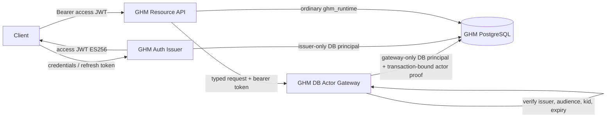

# Isolated issuer and database gateway — implementation design and qualification plan

**ADR:** [ADR-001](ADR-001-isolated-auth-issuer-and-db-actor-gateway.md)  
**Status:** Design baseline approved; implementation contracts and proof mechanism under qualification  
**Date:** 2026-11-10

## 1. Trust domains and data flow

The ordinary resource API is not a trusted identity issuer and is not a trusted database actor. It can authenticate a client request for HTTP routing, but all actor-sensitive database work crosses the gateway. The gateway validates the original access JWT itself; it must not trust an account ID or a "verified" boolean supplied by the resource API.

## 2. Process and credential isolation

### Authentication issuer

Owns:
- ES256 private key and active `kid`;
- refresh-token pepper and opaque refresh credential generation;
- password hasher and credential lookup/verification;
- registration, external identity linking, password change/recovery, session creation/refresh/revocation;
- issuance of the current GHM access/refresh response.

Dedicated environment (names are illustrative; final names are set in deployment plan):
- `GHM_ISSUER_DATABASE_URL`
- `GHM_ISSUER_ES256_PRIVATE_KEY` / protected key-store reference
- `GHM_ISSUER_ES256_PUBLIC_KEYS` or public-key distribution reference
- `GHM_ISSUER_REFRESH_TOKEN_PEPPER`

No issuer private key, refresh pepper, or issuer database credential may be present in the resource API environment. The issuer must not expose a `sign(accountId)`, `sign(payload)`, or arbitrary-claims operation to the resource API. The only token issuance path follows successful issuer-owned credential/session validation.

### Database actor gateway

Owns:
- issuer public-key set only (no private signing material);
- dedicated gateway database credential;
- typed operation registry and per-operation input/output schemas;
- DB actor-context proof mechanism, nonce/replay policy and bounded request handling.

Illustrative environment:
- `GHM_GATEWAY_DATABASE_URL`
- `GHM_GATEWAY_ISSUER_PUBLIC_KEYS`
- `GHM_GATEWAY_CONTEXT_KEY` only if the selected DB proof mechanism requires a symmetric proof; store separately from ordinary API configuration.

No gateway DB credential or context proof key may be present in the resource API environment. The resource API cannot request a token be signed or pass an arbitrary actor. Gateway service authentication from resource API is transport-level defense-in-depth, not user identity; user identity comes from the bearer token verified at the gateway.

### Ordinary resource API

Retains:
- normal application HTTP routing, input validation and public request handling;
- ordinary DB pool for operations that are explicitly classified as not actor-sensitive and do not expose privileged mutation;
- JWT verification for HTTP authentication if needed for compatibility.

Loses:
- ES256 private key and key-loading capability;
- refresh-token pepper;
- direct access to auth/session mutation functions;
- direct access to actor-sensitive RPCs/tables and gateway DB credentials;
- any ability to assert database actor identity.

## 3. Issuer operation contract

Public client-facing routes remain compatible. The resource API may initially reverse-proxy the auth endpoints to the issuer without reading or transforming secrets. The issuer owns the actual request handlers and persistence.

Required operations:
- `POST /v1/auth/register`
- `POST /v1/auth/login`
- `POST /v1/auth/refresh`
- `POST /v1/auth/logout`
- existing password recovery/change and external identity flows, after every route/caller is inventoried.

The exact public route shapes and error contracts must be copied from the existing auth router and contract tests, not re-invented. The issuer response preserves `accessToken`, `refreshToken`, `tokenType=Bearer`, `expiresIn=900`, `sessionId`, and `accountId` where currently exposed. Do not widen the issuer interface to accept `accountId` for issuance.

Issuer internal functions:
- credential lookup by normalized email;
- password verify/rehash;
- account creation and password setting;
- session create with first refresh token;
- refresh rotation and replay detection;
- logout/revoke;
- recovery/external identity operations.

The SQL layer must be reviewed so issuer-only functions cannot be called by `ghm_runtime`. For functions taking account IDs, validate that the ID is the account authenticated by the credential/session operation, or move the identity derivation fully into the function. The service boundary alone is not sufficient if the ordinary runtime retains EXECUTE.

## 4. Gateway typed operation contract

The gateway accepts a bearer token and an operation name from a closed enum. It does not accept SQL or SQL function names.

Initial operation registry (exact names and payloads to be derived from current repository call sites):
- `business.registrationIdentity.read`
- `business.registrationIdentity.update`
- `business.profile.update`
- `business.supplierClassification.update`
- `capability.draft.create`
- `capability.draft.update`
- `capability.lifecycle.transition`
- `business.engagement.record`

Each operation must:
1. Verify token signature and strict claims: ES256 only, known `kid`, `iss=ghm-auth`, `aud=ghm-api`, valid decimal `sub`, `iat`, `exp`, 15-minute maximum lifetime, and clock-skew policy matching current verifier.
2. Reject tokens with unsupported purpose/claims if purpose is introduced; current tokens have no purpose claim, so do not require one until separately versioned.
3. Derive actor account ID exclusively from verified `sub`.
4. Parse strict operation-specific input; unknown fields and caller-supplied actor IDs are rejected.
5. Begin a DB transaction, establish authenticated actor context using the selected proof mechanism, execute only the mapped operation, and commit/rollback atomically.
6. Protected SQL rechecks account active status and tenant membership/role at operation time.
7. Return a bounded, typed result without leaking password, refresh, recovery, internal DB, or signing details.

The gateway must not offer generic query, generic stored procedure, arbitrary table, arbitrary tenant, or arbitrary actor endpoints.

## 5. Transaction-bound DB actor proof: design spike

This is the most security-sensitive unresolved implementation detail. Do not ship a plain GUC, temp table, custom session variable, or actor-ID argument as proof.

Compare at least these candidates in disposable PostgreSQL:

### Candidate A — gateway-only DB principal with transaction-local context

- The gateway authenticates to PostgreSQL using a dedicated login that `ghm_runtime` cannot assume or inherit.
- Protected functions require `session_user` to be the dedicated gateway principal and take actor ID only from the gateway's typed call path.
- The context is transaction-local and cannot be written by `ghm_runtime`.
- Assess whether any gateway SQL credential user can issue arbitrary actor-ID calls and whether the gateway role can be restricted to EXECUTE on only typed procedures.
- If gateway DB principal alone is accepted as the actor assertion authority, document explicitly that compromise of gateway code/credential is equivalent to actor-assertion compromise; require least privilege, private network, credential rotation and audit.

### Candidate B — signed transaction-bound actor assertion

- Gateway validates the ES256 JWT and creates a short-lived actor assertion bound to account ID, purpose/operation set, DB transaction identifier, expiry and unique nonce.
- A database-owned verifier validates a MAC/signature using key material unavailable to `ghm_runtime`. No caller-writable GUC alone can bypass verification.
- Proof is consumed once inside the transaction; rollback semantics, replay persistence and transaction-ID binding must be tested.
- Gateway-only proof key is not exposed to the resource API. DB verifier key is not readable by gateway SQL roles.
- Evaluate transaction ID acquisition, transaction-pool compatibility, nonce storage/cleanup, key rotation, and whether gateway can call verifier but cannot impersonate outside its typed API.

### Candidate C — database-native asymmetric verification

- Evaluate whether the target PostgreSQL version/extensions can safely verify ES256/JWS without adding unsafe or unavailable extensions.
- If unavailable or operationally burdensome, reject rather than introduce a custom C extension or a fragile SQL crypto implementation.

Selection criteria:
- `ghm_runtime` cannot forge proof even with arbitrary SQL and all its existing grants;
- proof binds actor, transaction, purpose and expiry;
- replay across requests/connections/transactions fails;
- works with current PostgreSQL version and pool mode;
- no superuser, schema-owner, or migration credentials in runtime services;
- tests cover rollback, cancellation and connection reuse;
- operational key rotation and incident response are manageable.

No candidate is declared production-ready until its threat model and adversarial tests pass.

## 6. Auth SQL privilege transition

Build a complete caller matrix for the functions in `20260921130000_create_auth_runtime_functions.sql` and later migrations. At minimum classify:
- password lookup/set/change;
- session creation and validation;
- refresh rotation;
- single/all-session revoke;
- account disable;
- recovery issue/redeem;
- external identity lookup/bootstrap;
- internal revoke helpers;
- direct SELECT from authentication_session.

For each operation record current caller, target issuer caller, required DB grants, function owner, security-definer search_path, input identity provenance, and expected negative tests. Revoke runtime EXECUTE only after all production callers are moved and a separate production grant plan is approved.

## 7. Implementation milestones

| Milestone | Deliverable | Exit gate |
|---|---|---|
| M0 | ADR + source/caller inventory | Owner approval (recorded) |
| M1 | Threat model + DB proof spike | Runtime spoof tests pass; candidate selected |
| M2 | Issuer core and compatibility adapter | Auth contract tests pass; no resource API signing key |
| M3 | Gateway typed operation skeleton | Token validation and strict schema tests pass |
| M4 | DB actor context and protected RPC | Disposable PostgreSQL adversarial suite passes |
| M5 | One representative operation migrated | Positive and spoof tests; rollback tested |
| M6 | Remaining actor-sensitive operations | #236/#237/#243/#244/#250 suites pass |
| M7 | Auth/session privilege isolation | Caller inventory complete; issuer-only grants pass |
| M8 | Production rollout plan | Separate explicit approval for secrets, grants, migrations, services and deploy |

## 8. Required test fixtures

Disposable PostgreSQL only:
- active system admin A, active owner A, active owner B, ordinary member, disabled owner;
- business A and business B with distinct membership roles;
- valid and expired access JWTs signed by test-only ES256 keys;
- wrong `kid`, issuer, audience, algorithm, malformed subject, future/expired `iat`/ `exp`;
- forged actor and tenant payloads;
- proof replay, cross-transaction, cross-connection, concurrent and pool-reuse cases.

Tests must connect using the actual `ghm_runtime`, issuer and gateway roles. Superuser/owner fixtures may provision test state but must not execute the behavior under test.

## 9. Rollback and compatibility

- Keep existing public HTTP auth route contracts and response shapes.
- Do not invalidate currently issued tokens as a side effect of service extraction; retain key overlap for at least the maximum token lifetime plus clock skew.
- Rollback plan must restore old routing only while old credentials remain safely isolated; never restore private signing key to ordinary API as a shortcut after cutover.
- Database grants must be additive only during non-production qualification. Production revokes occur in a separately approved change after all callers have moved.
- Runtime API and gateway must fail closed when issuer keys are unknown, gateway is unavailable, or DB actor context cannot be established.
- Health checks must distinguish process health from ability to perform actor-authorized operations; do not expose secrets or DB details.

## 10. Scope

This plan is isolated design and qualification only. It does not create Render services, set production environment variables, rotate production keys, alter production grants, run active-database queries/migrations, change payment configuration, or deploy. PayFast and legal-document work remain parked as directed.

## 11. Implemented foundation and selected DB principal model — 2026-11-10

PR #257 merged the public-only ES256 verifier and public-only key loader. A compatibility issue was found during implementation: the prior signer used `noTimestamp: true`, which removed `iat` despite the intended contract. New tokens now emit `iat`; the verifier accepts legacy tokens without `iat` only while their expiry is within the existing 900-second lifetime plus 60-second skew. The test suite covers both formats.

PR #259 merged an additive database principal guard and disposable PostgreSQL qualification. The first selected DB actor model is a dedicated `ghm_actor_gateway` LOGIN NOINHERIT role with no role memberships/elevated attributes. The SECURITY DEFINER helper `ghm.assert_actor_gateway(bigint)` verifies `session_user`, active account state and positive account ID. Only this role can execute the helper; ordinary `ghm_runtime` cannot execute it, assume the role or read account/auth tables. The gateway verifies the JWT and derives actor ID from `sub`, then calls closed typed operations. This explicitly trusts the isolated gateway service as the actor assertion boundary; gateway compromise is therefore an actor-auth compromise.

The helper is not yet wired into feature RPCs and the migration does not revoke current runtime grants. Role provisioning remains out-of-band and must precede migration application; the migration fails closed if the role is absent or unsafe. CI provisions only a disposable test role and passed the complete migration chain, principal qualification, full suite, migration audit, runtime boundary, web-quality and Cloudflare checks.

Next: implement the gateway service and typed registry, migrate one representative low-risk read operation, then expand the shared actor gate across all inventoried RPCs and the analytics event insert. Production grants/credentials, migrations, provisioning and deployments remain separately authorized.

## 12. First gateway vertical slice merged — 2026-11-10

PR #261 merged a separate `src/actor-gateway/server.ts` entrypoint with public-only ES256 verification material and dedicated `GHM_ACTOR_GATEWAY_DATABASE_URL`. It exposes only typed `GET /v1/actor/me`; actor ID is derived from verified JWT `sub`, and the Postgres reader invokes `ghm.gateway_get_actor_identity(bigint)` inside a transaction. That SECURITY DEFINER function calls `ghm.assert_actor_gateway` and returns only the verified actor's own active identity. The route has no caller-selected actor input or generic SQL/RPC surface.

Exact-head CI passed quality, web-quality and Cloudflare Pages, including full disposable migration chain, gateway principal and typed-operation qualification, HTTP tests, full suite, migration audit and runtime boundary verification.

This is a self-read proof slice only. The ordinary resource API still retains its existing token-signing capability and current `ghm_runtime` privileges remain unchanged. Feature RPCs and analytics-event writes are not yet migrated. No production gateway service, environment variable, credential, role, grant, migration or deployment was changed.

Next milestone: migrate one existing actor-sensitive feature read to the gateway and require `ghm.assert_actor_gateway` inside its database function; qualify legitimate and forged cross-actor cases with actual disposable roles. Expand only after the representative operation is proven.

## 14. Resource API → Actor Gateway registration read integration (PR #265) — 2026-11-10

PR #265 introduces an HTTPS-only typed HTTP client and optional `GHM_ACTOR_GATEWAY_URL`. When configured, the existing resource API Business registration identity GET forwards the original bearer token to the gateway; resource API auth/operation authorization still runs first, and the gateway independently verifies the token and database membership. Gateway failures are fail-closed and never fall back to the legacy DB path. When unset, legacy behavior remains for controlled rollout.

Tests cover bearer forwarding, gateway mode avoiding legacy service calls, no fallback on gateway outage, response validation, HTTPS-only configuration and config validation. At handover time PR #265 is open and CI is pending. No production URL, service, credential, role/grant, migration execution or deployment changed.

Production rollout remains blocked on a separately provisioned gateway service using only gateway DB credentials and public ES256 verification keys, plus end-to-end HTTP/database qualification. Legacy runtime read grant must remain until the resource API is deployed and verified against the gateway. Next: exact-head CI, extend disposable database qualification through HTTP, then separately approve Render service provisioning and deployment ordering.

## 15. Business registration identity write gateway slice (PR #266) — 2026-11-10

PR #266 adds a gateway-only SECURITY DEFINER write wrapper guarded by `ghm.assert_actor_gateway`, with EXECUTE only for `ghm_actor_gateway`. It extends the typed gateway Postgres reader and PUT route, deriving actor ID only from independently verified JWT `sub` and accepting only the canonical registration declaration fields. The resource API client forwards the original bearer token for both registration GET and PUT when `GHM_ACTOR_GATEWAY_URL` is configured; gateway failures fail closed and never fall back to legacy SQL. Unset URL preserves legacy behavior for controlled rollout.

Disposable PostgreSQL qualification covers positive write, disabled actor denial, cross-business denial and ordinary runtime cannot execute the gateway write. HTTP/API tests cover actor binding, payload validation, token forwarding and no fallback. At handover PR #266 is open and CI pending. No production service, URL, credential, role/grant, migration execution or deployment has changed. Legacy runtime write grant remains until separate rollout approval and successful end-to-end verification.

Next: exact-head CI, then plan gateway/API service deployment order and end-to-end verification. Auth issuer isolation and remaining feature RPCs are separate milestones.
